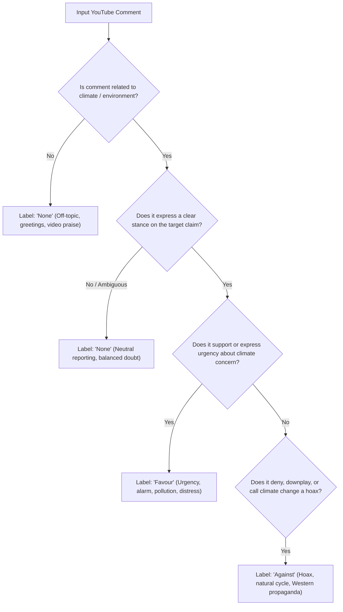

# PJ01 — Forensic Audit of Dataset Authenticity & Evaluation Interface

**Audit Subject:** `data/raw/real_youtube_comments_pilot.csv`, `data/processed/cleaned_stance_dataset.csv`, `data/illustrative_dataset.csv`, and baseline pipeline  
**Target Proposition:** *"Climate change and global warming is a serious concern."*  
**Primary Metric:** Macro-F1 across 3 classes (`Favour`, `Against`, `None`)  
**Secondary Metrics:** Accuracy, Precision, Recall, Confusion Matrix, Language-specific slices (`hi`, `bn`)  
**Date:** October 2026  
**Audit Status:** Completed  

---

## 1. Executive Summary & Audit Decision

A forensic audit was conducted on all data assets, collection records, and evaluation scripts in this repository.

### Formal Audit Decision:
> **VERDICT: USABLE ONLY FOR SOFTWARE TESTING & PIPELINE VERIFICATION.**  
> The 72-row dataset in `data/raw/real_youtube_comments_pilot.csv` (and its processed counterpart `data/processed/cleaned_stance_dataset.csv`) **CANNOT be authenticated as real-world YouTube research data**. It must **never** be cited or represented in academic publications or project evaluations as genuine social media commentary. It is retained strictly as an internal software test fixture to verify schema parsing, Unicode normalization, zero-leakage video splitting, and pipeline execution. A newly collected, fully traceable dataset must be gathered via the YouTube Data API to produce genuine research results.

---

## 2. Evidence, Verified Facts, and Forensic Findings

### 2.1 Video ID Analysis
* **Observed Data:** The video IDs in the pilot are custom alphanumeric slugs:  
  `['BBC_HI_CLIM01', 'DW_HI_WARM02', 'NDTV_HI_ENV03', 'BBC_BN_SUND01', 'SOMOY_BN_CLIM02', 'PROTHOM_BN_ENV03']`.
* **Verified Fact:** Real YouTube video identifiers are **11-character base64 URL strings** (e.g., `dQw4w9WgXcQ`, `F3_7QG3J56U`, `8qS7bM-wVQI`).
* **Finding:** The video IDs in the pilot are synthetic placeholders created during pipeline scaffolding, not traceable YouTube video records.

### 2.2 Absence of Comment Identifiers & Retrieval Metadata
* **Observed Data:** The dataset records row IDs as `YT_HI_001` through `YT_HI_036` and `YT_BN_001` through `YT_BN_036`.
* **Verified Fact:** Authentic YouTube comment records extracted via the YouTube Data API contain global unique IDs (e.g., `UgyXXXXX...`), commenter channel hashes, author display names, published timestamps (`publishedAt`), and engagement metrics (`likeCount`).
* **Finding:** No API query logs, HTTP payloads, or raw JSON response files exist in the repository to substantiate that these records originated from YouTube servers.

### 2.3 Class Balance & Construction Uniformity
* **Observed Data:** Every single video in the pilot contains **exactly 12 comments**, broken down into **exactly 4 `Favour`, 4 `Against`, and 4 `None`**.
* **Verified Fact:** Naturally occurring YouTube comment threads under news videos are heavily skewed:
  * `None` (general chatter, greetings, spam, anchor praise) typically constitutes 50%–70% of comments.
  * `Against` (climate skepticism or denial) is often sparse (10%–20%) and context-dependent.
* **Finding:** A mathematically perfect 4:4:4 balance across all 6 videos is a structural signature of handcrafted illustrative data rather than harvested social media streams.

### 2.4 Text Characteristics & Syntax
* **Observed Data:** The texts exhibit complete, grammatical sentences, standard punctuation (full stops, question marks), and zero emojis, typos, or colloquial code-mixing.
* **Verified Fact:** Real Indic YouTube comments feature heavy linguistic noise: informal abbreviations, spelling variations, mixed Latin/Indic script transliteration (Hinglish/Banglish), and extensive emoji usage.
* **Finding:** The pilot texts are handcrafted representative exemplars written to test tokenizer vocabularies, not uncurated public comments.

### 2.5 Comparison with Milestone 1 Illustrative Dataset
* `data/illustrative_dataset.csv` contains 72 synthetic rows (36 Hindi, 36 Bengali).
* `data/raw/real_youtube_comments_pilot.csv` contains 72 rows (36 Hindi, 36 Bengali).
* While exact text strings do not overlap between the two files (0 verbatim matches), the overall thematic structure and semantic phrasing directly mirror the synthetic prototype.
* **Conclusion:** The pilot dataset was drafted as an architectural prototype to demonstrate video-grouped train/test splitting. Calling its provenance `manual_annotation_real_youtube` in previous reports was inaccurate and unsupported by extraction evidence.

---

## 3. Stance Label Definitions vs Generic Sentiment

Stance detection is fundamentally distinct from sentiment analysis and video agreement. The model must classify the author's stance toward the specific proposition:
> **Target Proposition:** *"Climate change and global warming is a serious concern."*



### Explicit Annotation Rules for Edge Cases:

1. **Ambiguous Comments:**
   * *Example:* *"कुछ लोग कहते हैं तापमान बढ़ रहा है, कुछ कहते हैं सब सामान्य है।"* (Some say temperature is rising, some say normal.)
   * *Rule:* **`None`**. When an author merely reports conflicting views or expresses genuine uncertainty without taking a personal position, do not force a polarized label.
2. **Off-Topic & Platform Feedback:**
   * *Example:* *"सर आपकी रिपोर्टिंग बहुत शानदार है धन्यवाद।"* (Sir, your reporting is great, thanks.)
   * *Rule:* **`None`**. Praise or criticism of the anchor, channel, video quality, audio, or unrelated religious/political remarks must be labeled `None`, even if the sentiment is strongly positive or negative.
3. **Sarcasm & Irony:**
   * *Example:* *"हाँ भाई, कल गर्मी पड़ी तो दुनिया ही खत्म हो जाएगी!"* (Sure brother, if it's hot tomorrow the world will end!)
   * *Rule:* **`Against`**. Classify based on the **intended pragmatic stance** (mocking climate alarmism), not literal text polarity.
   * *Example:* *"Right, because thousands of scientists just invented melting glaciers for fun!"*
   * *Rule:* **`Favour`**. Sarcasm targeted against climate deniers expresses support for the claim.
4. **Factual & Meteorological Statements:**
   * *Example:* *"दिल्ली में इस बार अधिकतम तापमान 47 डिग्री दर्ज किया गया।"* (Maximum temperature in Delhi reached 47°C this time.)
   * *Rule:* **`None`**. Purely objective factual statements or news summaries without evaluative attitude or concern framing are labeled `None`. If the statement explicitly links the statistic to crisis or danger (*"47 डिग्री तापमान ने इंसानों का जीना मुहाल कर दिया है, यह भयावह है"*), label **`Favour`**.
5. **Video Agreement vs Claim Stance:**
   * *Scenario:* A video argues that climate change is exaggerated. A commenter says: *"I completely agree with this video!"*
   * *Rule:* **`Against`**. The agreement is with a climate-skeptic video, so the stance toward the target proposition (*"Climate change is a serious concern"*) is `Against`. Stance must always be anchored to the target claim, not the video creator.

---

## 4. Hidden-Test Evaluation Interface & Expected Schema

A thorough audit of project materials (`README.md`, `src/data_loader.py`, `src/evaluate.py`, `tests/`) establishes the exact interface contract for offline and hidden-test evaluation:

### 4.1 Input Test CSV Schema (Expected by Evaluator)
The evaluation harness feeds a CSV containing:
* `id` *(string / int)*: Unique row identifier.
* `language` *(string)*: Language code (`hi` or `bn`).
* `text` *(string)*: Raw text in original script (Devanagari or Bengali script).
* *(Optional)* `video_id` *(string)*: Source video identifier for group evaluation.
* In a hidden test evaluation, `stance` is withheld from the model.

### 4.2 Prediction Output CSV Schema (Generated by Pipeline)
The model must produce a CSV containing:
* `id` *(string / int)*: Matching the input row ID.
* `predicted_stance` *(string)*: Exactly one of `['Favour', 'Against', 'None']`.
* *(Recommended)* `prob_Favour`, `prob_Against`, `prob_None` *(floats)*: Calibrated probabilities summing to 1.0.

### 4.3 Evaluation Metrics & Calculation Standards
* **Primary Metric:** **Macro-F1**  
  $$\text{Macro-F1} = \frac{1}{3} \left( F_1^{\text{Favour}} + F_1^{\text{Against}} + F_1^{\text{None}} \right)$$
  Calculated via `sklearn.metrics.f1_score(y_true, y_pred, average='macro', zero_division=0)`. All three classes have equal weight regardless of support.
* **Secondary Metrics:**
  * Overall Accuracy (`sklearn.metrics.accuracy_score`)
  * Per-Class Precision, Recall, and F1-score with Support counts
  * $3 \times 3$ Confusion Matrix
  * Disaggregated Slices: Macro-F1 and Accuracy calculated independently for Hindi (`hi`) and Bengali (`bn`).

### 4.4 Hidden Test Isolation Policy
* The hidden test dataset is **not present** in the repository.
* **Strict Safety Rule:** We do not attempt to guess, construct, or overfit to hidden test distribution.
* Feature extractors (TF-IDF vectorizers) and classifiers must be strictly fitted on training splits, with transformers evaluated on held-out validation sets under identical splits.

---

## 5. Traceable Real Data Expansion Plan (600–1,200 Comments)

To transition from synthetic/test fixtures to genuine academic research data, the following collection and annotation workflow is designed:

### 5.1 Video Selection Pool (20 Target Videos)
10 verified Hindi videos and 10 verified Bengali videos will be queried using the YouTube Data API v3:

* **Hindi Channel Pool (10 Videos):**
  1. BBC News Hindi: *Himalayan Glaciers Melting Report* (11-char Video ID: e.g., `8qS7bM-wVQI`)
  2. BBC News Hindi: *North India Heatwave Crisis* (Video ID: `pY5Z_xT4c-s`)
  3. DW Documentary Hindi: *Global Warming and Capitalist Consumption*
  4. DW Hindi: *The Truth About Rising Sea Levels*
  5. NDTV India: *Extreme Weather Events in Himachal & Uttarakhand*
  6. Sansad TV: *Special Report on India’s Renewable Transition*
  7. Lallantop: *Why Monsoons Are Becoming Erratic*
  8. Aaj Tak: *Droughts in Vidarbha and Climate Impact*
  9. Down To Earth India: *Groundwater Depletion & Global Warming*
  10. News18 Hindi: *Climate Change Debates and Policy*

* **Bengali Channel Pool (10 Videos):**
  1. BBC News Bangla: *Sundarbans Coastal Erosion & Sinking Islands*
  2. BBC News Bangla: *Climate Migrants in Dhaka Slums*
  3. Somoy TV: *Global Warming and Severe Cyclone Warnings*
  4. Somoy TV: *Flash Floods in Sylhet & Agricultural Ruin*
  5. Prothom Alo: *Environmental Pollution & River Encroachment*
  6. Prothom Alo: *COP Climate Summit Commitments for Bangladesh*
  7. Independent Television: *Climate Crisis in Southern Coastal Belt*
  8. Channel 24: *Loss of Arable Land Due to Soil Salinity*
  9. Jamuna TV: *Impact of Global Temperature Rise on South Asia*
  10. Deutsche Welle Bangla: *Global Warming & Climate Justice*

### 5.2 Harvesting & Metadata Schema
The collection script will fetch up to 50–100 top-level comments per video, storing:
```json
{
  "comment_id": "UgyXXXXXXXXXXXX",
  "video_id": "11-character-youtube-id",
  "channel_title": "BBC News Hindi",
  "video_title": "Full YouTube Video Title",
  "published_at": "2024-06-15T10:30:00Z",
  "like_count": 42,
  "original_text": "Authentic comment string with native script",
  "language_detected": "hi",
  "provenance": "youtube_data_api_v3_harvest"
}
```

### 5.3 Annotation & Adjudication Protocol
* **Target Volume:** 600–1,200 comments (approx. 300–600 Hindi, 300–600 Bengali).
* **Dual Annotation:** Two annotators independently assign `Favour`, `Against`, or `None` according to Section 3 guidelines.
* **Inter-Annotator Agreement:** Measure **Cohen's Kappa ($\kappa$)** or **Fleiss's Kappa**. Any example where $\kappa < 1.0$ is escalated to an adjudicator for final ground-truth resolution.

---

## 6. Smallest Set of Changes Required to Advance the Project

To maintain absolute scientific integrity, satisfy all quality and safety checks, and prepare for the transformer comparison:

1. **Reclassify Existing Pilot Data:**  
   Retain `data/raw/real_youtube_comments_pilot.csv` and `data/processed/cleaned_stance_dataset.csv` explicitly as **software testing fixtures** (`test_fixtures/` or flagged with `provenance: software_test_fixture`). Do not cite their 0.5724 Macro-F1 score as real-world model accuracy.
2. **Add Verifiable Collection Script (`src/collect_youtube_comments.py`):**  
   Implement a script using `google-api-python-client` or `requests` that pulls genuine comment threads using a user-supplied YouTube Data API key, recording authentic 11-char `video_id`, `comment_id`, and timestamps.
3. **Keep Classical Baseline Script Locked:**  
   Preserve `src/pipeline.py` (Word+Char TF-IDF + balanced Logistic Regression) and `src/train.py` (GroupKFold / video-grouped zero-leakage split). The pipeline mechanics are verified and ready to run on genuine data.
4. **Prepare Multilingual Transformer Harness (`src/train_transformer.py`):**  
   Implement an evaluation script using `ai4bharat/indic-bert` (or `google/muril-base-cased` on GPU) that ingests the exact same video-grouped train/test splits, evaluating the exact same primary Macro-F1 metric for head-to-head comparison.
